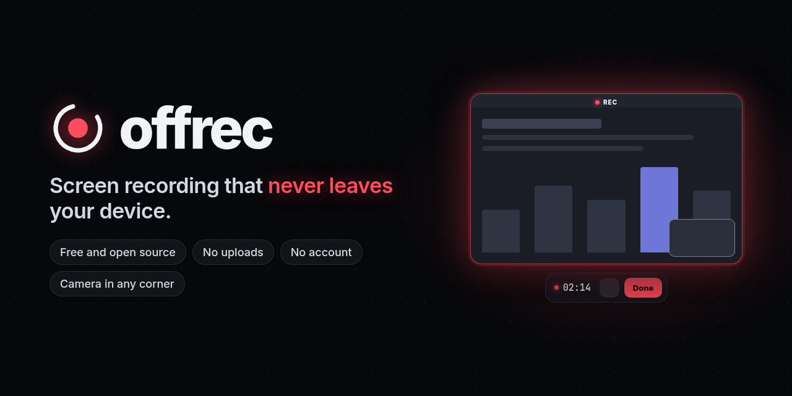

<p align="center">
  
</p>

<h1 align="center">offrec</h1>

<p align="center"><strong>Screen recording that never leaves your device.</strong></p>

<p align="center"><a href="https://offrec-one.vercel.app/record/"><strong>Start recording</strong></a> · <a href="https://offrec-one.vercel.app">Website</a></p>

<p align="center"></p>

Offrec is a free, open-source screen recorder that runs entirely in your browser. Pick a window, a tab or your whole screen, add your camera in any corner, record, then save the video straight to your computer. No account, no uploads, no tracking.

## Features

- **Record a window, a tab or your entire screen**, with sound from your microphone and from the shared tab.
- **Camera overlay** on top of your screen. Snap it to any corner or drag it anywhere, and resize it from its corners.
- **Floating Pause and Stop controls** (Chrome and Edge) that stay on top of the app you are recording, and never appear in the video.
- **3-second countdown** after you press Record, so you can switch to what you want to record. Cancel it with <kbd>Esc</kbd>.
- **Pause and resume** without gaps in the video.
- **Review before saving**: watch the recording, name it, save it as many times as you like.
- **Keyboard shortcuts**: <kbd>Space</kbd> record / pause, <kbd>Esc</kbd> cancel the countdown, <kbd>M</kbd> microphone, <kbd>C</kbd> camera.
- Dark and light themes that follow your system, and reduced motion support.

## Privacy

Nothing leaves your device:

- Recording, compositing and encoding all happen in your browser. There is no server.
- No accounts, cookies, local storage, analytics or error reporting.
- Fonts are bundled with the app, so the page never contacts Google or any other third party.
- A strict Content Security Policy (`connect-src 'none'`) makes it impossible for the page to send data anywhere.

## Browser support

| Browser | Status |
| --- | --- |
| Chrome / Edge (desktop) | Full support, including floating controls |
| Firefox (desktop) | Supported. No floating controls: finish with the browser's Stop sharing bar or come back to the tab |
| Safari (macOS) | Should work, not yet tested |
| Phones and tablets | Not supported: mobile browsers can't capture the screen |

Screen capture requires a secure page: `https://` or `localhost`.

## Run it locally

Requires Node.js 18 or newer.

```bash
npm install
npm run dev       # development server at http://localhost:5173
npm run build     # type-check and build to dist/
npm run preview   # serve the production build at http://localhost:4173, with the production security headers
```

## Deploy to Vercel

1. Push this repository to GitHub.
2. In Vercel, choose **Add New → Project** and import the repository.
3. Keep the detected settings (framework **Vite**, build command `npm run build`, output `dist`) and deploy.

`vercel.json` sets the security headers (Content Security Policy, Permissions Policy, Referrer Policy) on every route. Any other static host works too, as long as you add the same headers.

## How it works

- In Chrome and Edge, frames are read straight from the screen and camera streams (`MediaStreamTrackProcessor`), composited on an off-page canvas, and handed to `MediaRecorder` through a `MediaStreamTrackGenerator`, together with a Web Audio mix of the microphone and tab audio. None of this depends on the Offrec tab being visible, so recording keeps going while you work in other windows. Firefox uses hidden `<video>` elements and `canvas.captureStream()` instead.
- Recordings are 1080p, or 720p on computers with 4 or fewer CPU threads so the video encoder can keep up.
- The draw loop is driven by a Web Worker timer instead of `requestAnimationFrame`, so recording keeps running smoothly while the tab is in the background.
- The floating controls use the Document Picture-in-Picture API. They are only offered when you share a single window or tab, because a window or tab capture contains only that surface, so the controls can't end up in the video.
- Output is MP4 where the browser supports it, otherwise WebM.

Source layout:

```
src/
  engine/Session.ts      capture session: streams, compositor, audio graph, recorder
  engine/tick.worker.ts  background-safe draw timer
  engine/mime.ts         recording format selection
  state.ts               the app's state machine
  App.tsx                wires the state machine, session and floating window together
  landing/               the landing page at / (the recorder lives at /record/)
  components/            screens and controls
  lib/                   overlay geometry, file names, formatting
```

## How long can I record?

There is no time limit. The recording is kept in your browser's memory until you save it, so up to about an hour is comfortable on most computers; longer depends on how much memory you have. Video is capped at 5 Mbps, so a recording takes at most about 38 MB per minute (about 2.3 GB per hour); still screens like slides or code are usually much smaller.

Save your recording before closing the tab: an unsaved recording is lost if the tab or browser closes.

## Known limitations

- If you share a window and then minimize it, most systems stop sending its picture, so the video freezes until you bring it back.
- When you record your entire screen, the browser's own "sharing your screen" bar may appear in the video. Most browsers let you hide it.
- If the computer goes to sleep, capture stops.

## License

[MIT](LICENSE)
